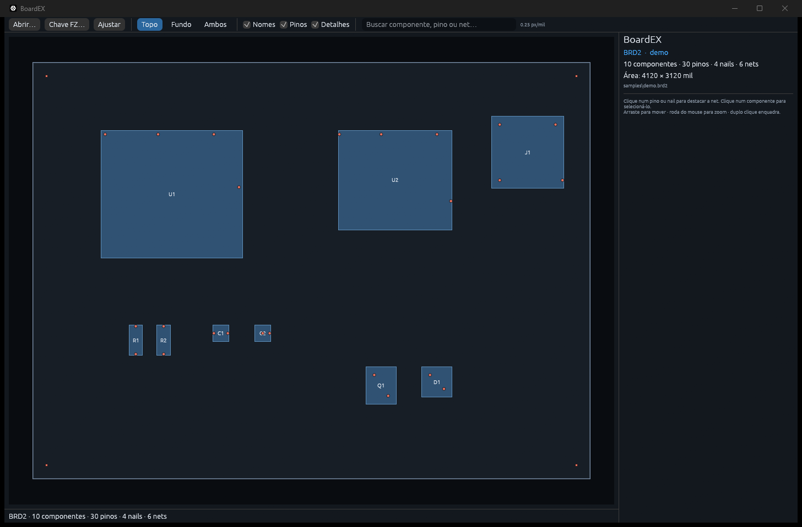

# BoardEX

Visualizador de **boardview** desktop, leve e independente, escrito em Rust com **egui/eframe + wgpu**. O objetivo é abrir arquivos de placa com rapidez, navegar com pan/zoom suave, inspecionar componentes/pinos/nets e servir de base para uma ferramenta pessoal de reparo eletrônico.

Repositório: <https://github.com/Paul-Henrique/BoardEX>



> Implementação **clean-room**. Nenhum código, binário, ícone ou ativo do FlexBV é usado. O OpenBoardView (MIT) foi consultado apenas como documentação factual dos formatos de arquivo. Os parsers deste projeto foram escritos em Rust.

## Estado atual

- MVP funcional de visualização.
- Detecção automática de formato pelo conteúdo; `.fz` é reconhecido pela extensão e também por conteúdo quando não está cifrado.
- Aceita arquivo `.fz` ou uma pasta/pacote contendo um único `.fz` (busca recursiva até 4 níveis).
- Pan, zoom no cursor, zoom por teclado, “fit” e enquadramento de componente/net.
- Camadas Topo / Fundo / Ambos, com espelhamento horizontal na vista de fundo.
- Desenho de contorno da placa, segmentos, componentes, pinos e nails/test points.
- Seleção de componente, pino e nail; destaque de todos os pinos/nails da net selecionada.
- Busca por nome de componente, número/nome de pino e net.
- Painel de detalhes com valores, fabricante, contagem de pinos e avisos de parse.
- Drag-and-drop de arquivos ou pastas na janela.
- Diálogo **Chave FZ…** para colar a chave RC6 ou carregar um arquivo `obv.conf`/texto; abre automaticamente quando um `.fz` cifrado precisa de chave e permite tentar novamente sem reiniciar.
- Tema escuro e renderização por GPU.

## Formatos suportados

| Formato | Detecção | Estado | Observações |
|---|---|---|---|
| **BRD2** | `BRDOUT:`, `NETS:`, `PARTS:`, `PINS:` | Validado com amostra sintética | Lados 1/2, espelhamento de componentes/pinos do lado inferior, associação por índice inicial de pinos |
| **BRD** | cabeçalho `BRDOUT` codificado | Implementado | Inclui decodificação XOR do cabeçalho; validação apenas sintética |
| **BVR** | `BVRAW_FORMAT_1` | Validado com amostra sintética | Seções `<<Layout>>`, `<<Pin>>`, `<<Nail>>`; coordenadas em polegadas convertidas para mil |
| **BVR3** | `BVRAW_FORMAT_3` | Validado com amostra sintética | `PART_*`, `PIN_*`, `OUTLINE_POINTS`, `OUTLINE_SEGMENTED`; montagem de contorno por encadeamento de segmentos |
| **BDV** | marcador `dd:1.3?,r?-=bb` | Validado por ida-e-volta do decodificador | Texto ofuscado por chave rolante; seções `format/pins/nails` |
| **BVR2** | `BVRAW_FORMAT_2` | Melhor esforço | Layout/Overlay/Pin/Nail/Parts; baseado na estrutura documentada e em decompilação factual. **Sem amostra real disponível para validação.** |
| **FBV** | assinatura `FBV0001` | Melhor esforço | Corpo BVR2 cifrado com XOR (`key_size = byte[6] * 128`, dados em `8 + key_size`). **Sem amostra real disponível para validação.** |
| **FZ** | extensão `.fz`; zlib sem cifra também por conteúdo | Sem cifra validado com amostra sintética; RC6 validado com fixture independente; amostra ASUS real identificada como RC6 | Contêiner zlib com blocos `A!REFDES`, `A!NET_NAME` e `A!TESTVIA`; RC6 opcional com chave de 44 palavras fornecida pelo usuário. A amostra real só pode ser validada com a chave correspondente. |

### FZ criptografado

Muitos arquivos `.fz` usam RC6 além do zlib. O BoardEX **não embute nenhuma chave**: use uma chave que você já possua e tenha direito de usar. A chave tem 44 palavras de 32 bits em hexadecimal, separadas por espaço ou vírgula.

Pela interface, use **Chave FZ…** (ou aguarde o diálogo abrir automaticamente ao tentar abrir um `.fz` cifrado). Cole a chave e clique em **Aplicar e reabrir**. O botão **Carregar chave…** aceita um `.conf`/`.txt` com uma linha no formato do OpenBoardView:

```ini
FZKey = 0x12345678, 0x9abcdef0, ...   # 44 palavras
```

Linhas iniciadas por `#` ou `;` são ignoradas, então um exemplo comentado não é usado por engano.

Com variável de ambiente:

```powershell
$env:BOARDEX_FZ_KEY = "0x12345678, 0x9abcdef0, ..."   # 44 palavras
BoardEX placa.fz
```

Ou por linha de comando:

```bash
BoardEX --fz-key "0x12345678, 0x9abcdef0, ..." placa.fz
BoardEX --fz-key-file obv.conf placa.fz
```

O caminho RC6 é coberto por um fixture sintético gerado com uma implementação independente. Também foi testada uma amostra ASUS real: o contêiner é RC6 e só abre com a chave correspondente; sem ela o BoardEX informa que a chave é necessária. Arquivos `.fz` sem cifra abrem automaticamente.

Também é possível passar a pasta do pacote em vez do arquivo, por exemplo uma pasta com o nome terminando em `.fz` que contém o `.fz` real. O BoardEX procura recursivamente até 4 níveis e usa o arquivo quando há exatamente um `.fz`; se houver vários, pede que um seja escolhido.

### Limitações conhecidas

- BVR2/FBV ainda não foram testados contra arquivos reais; campos opcionais podem exigir ajustes.
- BVR3 não desenha `PART_OUTLINE_RELATIVE`/`PIN_OUTLINE_RELATIVE` (o OpenBoardView também ignora esses campos hoje). Componentes são mostrados pelo retângulo/limites calculados.
- FZ cifrado depende de uma chave RC6 válida fornecida pelo usuário; não há chave embutida nem tentativa de contornar licenciamento.
- FZ não desenha a seção `GRAPHIC_DATA`/`UnDrawSym` (o OpenBoardView também a ignora); o contorno é gerado a partir da extensão dos pinos e nails.
- Não há suporte ainda a TVW, XZZ, ODB++, IPC-356, PADS ASCII, Allegro e outros formatos proprietários.
- Anotações, medições, camadas de cobre, exportação de imagens e lista de materiais ainda não fazem parte deste MVP.
- Não há edição de placa: o foco é visualização e inspeção.

## Arquitetura

```
src/
  main.rs            entrada eframe, CLI e viewport
  app.rs             UI egui: toolbar, painel lateral, câmera, render e busca
  model.rs           modelo neutro: Pt, BBox, Board, Part, Pin, Nail, nets
  formats/
    mod.rs           detecção, registry e LoadError
    text.rs          decodificação UTF-8/CP1252, tokenização e parsers numéricos
    brd.rs           BRD + decodificação do cabeçalho
    brd2.rs          BRD2
    bvr.rs           BVR (BVRAW_FORMAT_1)
    bvr3.rs          BVR3 (BVRAW_FORMAT_3)
    bdv.rs           BDV + codec de ofuscação
    bvr2.rs          BVR2 e FBV
    fz.rs            FZ (zlib/RC6), blocos REFDES/NET_NAME/TESTVIA
```

O modelo usa **mil** (milésimo de polegada) como unidade interna. Cada parser traduz o formato de origem para o mesmo `Board`; a UI não conhece detalhes de formato.

## Compilar e executar

Pré-requisitos:

- Rust estável (testado com 1.99.1).
- Toolchain GNU no Windows precisa de um linker/compilador disponível (por exemplo, WinLibs MinGW-w64 UCRT).
- GPU/driver com suporte a Vulkan/DX12 para o backend wgpu.

```bash
cargo run --release -- caminho/para/placa.brd2
```

Para validar a leitura sem abrir a interface:

```bash
cargo run -- --inspect samples/demo.bvr3
```

A pasta `samples/` contém arquivos **sintéticos** para testar cada parser; veja `samples/README.md`.

Ou compile e abra o executável sem argumento, usando **Abrir…** ou arrastando um arquivo para a janela:

```bash
cargo build --release
./target/release/BoardEX.exe
```

### Caminho com acentos

O linker GNU pode falhar quando o projeto está em um caminho não-ASCII. Nesse caso, crie um `.cargo/config.toml` local (ele é ignorado pelo git) apontando `target-dir` para um diretório ASCII:

```toml
[build]
target-dir = "C:/caminho/ascii/boardex-target"
```

Ajuste ou remova essa configuração se o projeto estiver em um caminho ASCII.

### Testes

```bash
cargo test
```

Os testes cobrem tokenização, decodificação CP1252, codec BDV, formatos BRD/BRD2/BVR/BVR2/BVR3/FZ, unidades milímetros do FZ, chave FZ (bruta e linha `FZKey`), resolução de pasta com `.fz` aninhado e montagem de contorno.

## Controles

| Ação | Controle |
|---|---|
| Abrir arquivo ou pasta | botão **Abrir…**, `Ctrl+O` ou drag-and-drop |
| Informar chave FZ | botão **Chave FZ…**; o diálogo também abre ao detectar `.fz` cifrado |
| Mover a placa | arrastar com botão esquerdo ou do meio |
| Zoom | roda do mouse, pinch ou `+` / `-` |
| Ajustar à janela | **Ajustar**, `F` ou `Home` |
| Vista Topo / Fundo / Ambos | botões ou `T` / `B` / `A` |
| Buscar | campo de busca ou `Ctrl+F`; `Enter` enquadra o primeiro resultado |
| Selecionar pino | clique no pino |
| Destacar net | clique num pino ou nail |
| Selecionar componente | clique dentro do componente |
| Enquadrar | duplo clique no componente/pino |
| Limpar seleção | `Esc` |
| Mostrar/ocultar nomes | `N` |
| Mostrar/ocultar pinos | `P` |

Ao selecionar um pino ou nail, a net dele é destacada em amarelo em toda a placa. O painel lateral permite enquadrar o componente, a net ou o pino.

## Próximos passos sugeridos

1. Obter a chave da amostra FZ real (ou outra amostra cifrada acompanhada da chave) para validar o caminho RC6 completo; obter amostras reais de BVR2/FBV para validar campos opcionais.
2. Adicionar TVW e XZZ.
3. Renderização de cobre/planos e camadas internas.
4. Régua/medição, anotações persistentes e marcadores de reparo.
5. Exportação de imagem/PDF e relatório de nets.
6. Melhorar a busca com filtros por lado, tipo de componente e net.
7. Cache de geometria por camada e instancing de pinos para placas muito grandes.

## Licença

MIT. Consulte `LICENSE`.

## Aviso

Boardview é um formato usado por diversas ferramentas comerciais. Nomes de produtos e marcas pertencem aos seus respectivos donos. Este projeto não contém código proprietário e não implementa bypass de licenciamento; ele lê arquivos fornecidos pelo usuário para fins de inspeção e reparo.
